<div align="center">


<br/><br/>

<i>“I'll be there for you.”</i> &nbsp;— and by that I mean when prod goes down at 2 a.m.

<i>“How you doin'?”</i> &nbsp;— I'm a Python Full-Stack Developer who could not BE more into backends and AI.

<br/><br/>

<a href="https://anam-zahid-portfolio.onrender.com"></a> <a href="https://www.linkedin.com/in/anamzahid126/"></a> <a href="mailto:anamzahid126@gmail.com"></a> <a href="https://instagram.com/anam_zahid.78"></a> <a href="https://anam-zahid-portfolio.onrender.com/static/assets/Anam_Zahid_Resume.pdf"></a>

<br/><br/>


</div>

<br/>


<h2 align="center">☕ &nbsp;The One With the Intro &nbsp;☕</h2>

<table border="0"><tr>
<td width="54%" valign="top">

```yaml
name:        Anam Zahid
role:        Python Full-Stack Developer
company:     Quess Corp · Client: Ethara AI
apartment:   Gurugram, India  (purple door, yellow frame)
education:   MCA — MMMUT Gorakhpur
experience:  3+ years   # "seven years" was Ross's thing

this_season:
  - evaluating AI agents & foundation models
  - SFT dataset prep · rubric-based eval · pass@k
  - ARC-AGI-3 training games & eval harnesses
  - Odoo addons + REST APIs for analytics

catchphrase: "Could I BE any more full-stack?"
lobster:     a green CI pipeline
open_to:     [Python Backend, AI/LLM Engineering, GenAI]
```

</td>
<td width="46%" valign="top">

🛋️ **Backend first.** 3+ years shipping production systems with Python, Django, DRF, FastAPI & React.

🤖 **Now in AI.** Agent & model evaluation at Ethara AI — benchmarks, SFT data, sandboxed runs with OpenHands SDK, LiteLLM & Docker.

🏦 **FinTech.** End-to-end NBFC lending backend: KYC, loan lifecycle, e-sign, multilingual, SMS/WhatsApp/push.

🧾 **HRMS.** Payroll engine, offboarding, full ATS & multi-tenant architecture for BharatPayroll.

🏆 **Recognised.** Best Performer & Rising Star awards at Jewar International.

😂 **Fun fact.** I laugh at serious situations — Chandler would approve.

</td></tr></table>


<h2 align="center">📣 &nbsp;The One With the Quotes &nbsp;📣</h2>
<p align="center"><sub>— lines from the show, translated into how I actually work —</sub></p>

<table align="center">
<tr><th align="left">They said</th><th align="left">I heard</th></tr>
<tr><td><b>“PIVOT! PIVOT!”</b></td><td>Refactor the architecture before the couch gets stuck on the stairs.</td></tr>
<tr><td><b>“We were on a break!”</b></td><td>Feature branches. Always. Nothing lands on <code>main</code> mid-argument.</td></tr>
<tr><td><b>“Joey doesn't share food!”</b></td><td>Secrets stay in env vars. Nobody gets a bite of the API keys.</td></tr>
<tr><td><b>“Could I <i>BE</i> any more sarcastic?”</b></td><td><code>pytest -v</code> on every PR — the tests do the talking.</td></tr>
<tr><td><b>“Unagi.”</b></td><td>Total awareness: centralised logging, job statuses, notifications that fire before anyone asks.</td></tr>
<tr><td><b>“It's a moo point.”</b></td><td>Premature optimisation. Ship it, measure it, then fix the thing that's actually slow.</td></tr>
<tr><td><b>“Seven! Seven! Seven!”</b></td><td>That's the number of years of friendship I'm hoping for with your codebase.</td></tr>
</table>


<h2 align="center">🎬 &nbsp;The One With the Stack &nbsp;🎬</h2>

<div align="center">


<br/>


</div>

<br/>

<p align="center"><sub>— the cast, and which part of my stack each one plays —</sub></p>

<table align="center">
<tr><th align="left">Character</th><th align="left">In my codebase</th></tr>
<tr><td><b>🧹 Monica</b><br/><sub><i>obsessively organised</i></sub></td><td>Clean schemas, typed APIs, tidy migrations — PostgreSQL · Django ORM · Pydantic</td></tr>
<tr><td><b>🦖 Ross</b><br/><sub><i>"we were on a break" (from legacy code)</i></sub></td><td>Refactors, query optimisation, raw SQL when the ORM won't</td></tr>
<tr><td><b>🛋️ Chandler</b><br/><sub><i>could this BE any more tested?</i></sub></td><td>pytest · model testing · rubric-based evaluation · pass@k</td></tr>
<tr><td><b>🍕 Joey</b><br/><sub><i>doesn't share food — or secrets</i></sub></td><td>Auth (OTP/MPIN), KYC, sandboxing with Docker & nftables</td></tr>
<tr><td><b>🎸 Phoebe</b><br/><sub><i>sees what others don't</i></sub></td><td>AI agent & LLM evaluation · prompt engineering · SFT data · OpenHands SDK · LiteLLM</td></tr>
<tr><td><b>👗 Rachel</b><br/><sub><i>gets it shipped, looks good doing it</i></sub></td><td>React · TypeScript · FastAPI · AWS · Kubernetes</td></tr>
</table>


<h2 align="center">📺 &nbsp;Episode Guide &nbsp;📺</h2>
<p align="center"><sub>— four seasons so far, renewed indefinitely —</sub></p>

<table align="center">
<tr><th align="left">Season</th><th align="left">Episode</th><th align="left">Plot</th></tr>
<tr><td><b>S04 · 2026 →</b></td><td><b>The One Where She Evaluates AI Agents</b><br/><sub>Quess Corp · <i>Client: Ethara AI</i> — Python Full-Stack Developer</sub></td><td>AI agent & foundation-model evaluation, SFT datasets, ARC-AGI-3 training games & harnesses, Odoo addons & REST APIs</td></tr>
<tr><td><b>S03 · 2025</b></td><td><b>The One With the Payroll</b><br/><sub>Pranathi Software · <i>BharatPayroll</i> — Python Developer</sub></td><td>Payroll engine, offboarding workflow, full ATS, referral system, multi-tenant HRMS</td></tr>
<tr><td><b>S02 · 2025</b></td><td><b>The One With All the Loans</b><br/><sub>Jewar International · <i>Anekk Fintech</i> — Python/Django Developer</sub></td><td>NBFC backend, KYC flows, loan lifecycle, integrations, AWS deploy &nbsp;🏆 <i>Best Performer · Rising Star</i></td></tr>
<tr><td><b>S01 · 2023–25</b></td><td><b>The One Where It All Began</b><br/><sub>Masthead Technologies — Python Developer</sub></td><td>Large-scale e-commerce scrapers, proxy rotation, CAPTCHA handling, data pipelines</td></tr>
</table>


<h2 align="center">🏠 &nbsp;The One With the Projects &nbsp;🏠</h2>

<table align="center">
<tr><th align="left">Set</th><th align="left">Project</th><th align="left">What happens there</th><th align="left">Built with</th></tr>
<tr><td><b>🗺️ Monica's Apartment</b></td><td><a href="https://github.com/AnamZ78/hrms-lite"><b>HRMS Lite</b></a></td><td>Everyone accounted for — employees, attendance (Present/Absent/Late/Half Day), date filters, live dashboard</td><td>React · TypeScript · FastAPI · PostgreSQL</td></tr>
<tr><td><b>💸 Joey's Bank Account</b></td><td><b>Anekk NBFC Backend</b> <i>(private)</i></td><td>Full KYC, loan application → disbursement, e-sign, PDFs, multilingual, SMS/WhatsApp/push</td><td>Django · DRF · PostgreSQL · AWS</td></tr>
<tr><td><b>🕵️ Phoebe's Private Eye</b></td><td><b>Scraper Fleet</b> <i>(private)</i></td><td>Automated e-commerce scrapers with proxy rotation, CAPTCHA bypass & fault-tolerant scheduling</td><td>Selenium · BeautifulSoup · Pandas · MySQL</td></tr>
<tr><td><b>🖼️ The Yellow Frame</b></td><td><a href="https://github.com/AnamZ78/portfolio"><b>Portfolio</b></a></td><td>The view through the peephole — live at <a href="https://anam-zahid-portfolio.onrender.com">anam-zahid-portfolio.onrender.com</a></td><td>FastAPI · React · framer-motion</td></tr>
</table>


<h2 align="center">☕ &nbsp;Meet Me at Central Perk &nbsp;☕</h2>

<div align="center">

Open to <b>Python Backend</b>, <b>AI / LLM Engineering</b> and <b>Python + GenAI</b> roles — remote or Gurugram.<br/>
The orange couch is reserved. I'll be there for you.

<br/><br/>

<a href="mailto:anamzahid126@gmail.com"></a>
<a href="https://www.linkedin.com/in/anamzahid126/"></a>

<br/><br/>


<br/>

<sub><i>So no one told you life was gonna be this way… but the build is green.</i></sub>

</div>


